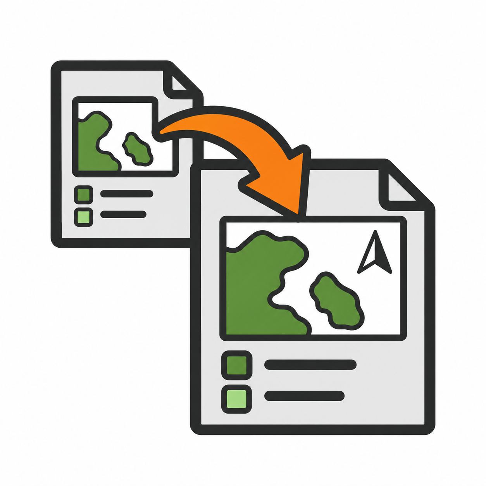

# Import Layouts from Project — QGIS plugin



Import all or selected **print layouts** (and **reports**) from another `.qgs` / `.qgz` project into the
current QGIS project — without opening the other project and without exporting `.qpt` templates one by one.

## Features

- Pick a source `.qgs` or `.qgz` project. It is only parsed as XML, so its layers are never loaded
  and you get no broken-data-source dialogs or credential prompts.
- Choose one, several or all layouts from a checkable, filterable list.
- **Automatic layer remapping.** Layer references in the imported layouts are pointed at the layers
  of the current project. This covers map layer sets, legends, atlas coverage layers, attribute tables
  and layer IDs in expressions. Layers are matched in this order:
  1. same layer ID
  2. same layer name (ties are broken by data source, then provider)
  3. same layer name, ignoring case
  4. same data source (relative paths are resolved against the source project)
- Review the proposed mapping in a table and override any match by hand before importing.
- Handle name clashes by importing with a new name ("Map (2)"), replacing the existing layout, or skipping it.
- A summary at the end warns about layers that could not be mapped, missing map themes and missing
  atlas coverage layers. It is also written to the *Import Layouts* tab of the log panel.

## Where to find it

- **Plugins ▸ Import Layouts from Project ▸ Import Layouts from Project…**
- **Layout ▸ Import Layouts from Project…** in any layout designer window

## Installation

1. Download `import_layouts-<version>.zip` from the [latest release](https://github.com/danzig666/qgis-import-layouts/releases/latest).
2. In QGIS open **Plugins ▸ Manage and Install Plugins… ▸ Install from ZIP**, select the zip and click **Install Plugin**.

Requires QGIS 3.22 or newer, and works with QGIS 4 (Qt 6).

## Limitations

- Only layouts are copied, not the layers they use. Layers that cannot be matched stay unmapped
  and are listed in the summary.
- Map themes referenced by map items must exist in the current project under the same name.

## Building the zip

```bash
python build_zip.py
```

This writes `dist/import_layouts-<version>.zip`, ready for *Install from ZIP*.

## License

GPL-2.0-or-later — see [LICENSE](LICENSE).
